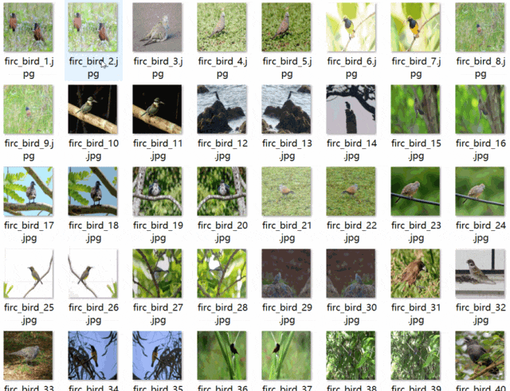
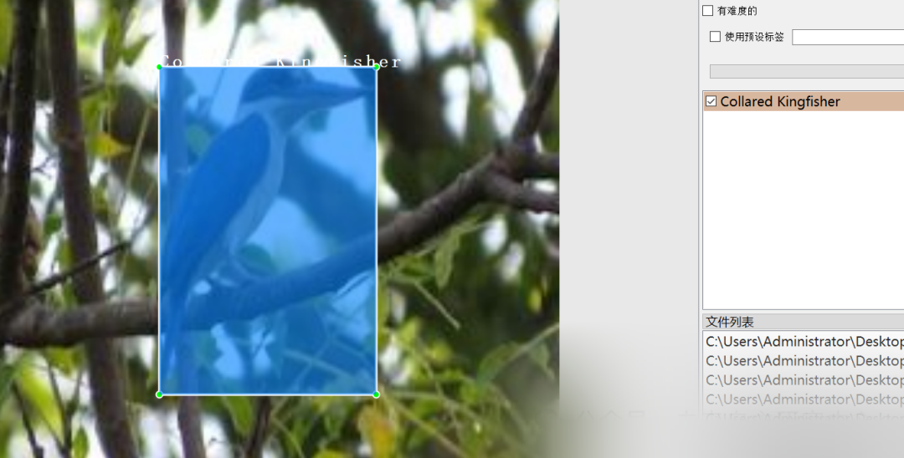

# [Dataset] Object Detection - Birds Detection VOC+YOLO format with 16,283 images in 10 categories

Dataset format: Pascal VOC format + YOLO format (txt file without split path, only containing jpg images and corresponding VOC format xml files and yolo format txt files)
Number of images (number of jpg files): 16283
Number of annotations (number of xml files): 16283
Number of annotations (number of txt files): 16283
Label category count: 10
Annotation category names: ["Asian Glossy Starling", "Chestnut Munia", "Collared Kingfisher", "Crested Myna", "Eurasian Tree Sparrow", "Garden Sunbird", "Lowland White-eye", "Philippine Pied-Fantail", "Red Turtle Dove", "Zebra Dove"]
Number of boxes labeled in each category:

Serial Number || Category Name || Box Count

1 || Asian Glossy Starling || 1956
2 || Chestnut Munia || 1916
3 || Collared Kingfisher || 1614
4 || Crested Myna || 1842
5 || Eurasian Tree Sparrow || 2051
6 || Garden Sunbird || 1588
7 || Lowland White-eye || 3403
8 || Philippine Pied-Fantail || 1782
9 || Red Turtle Dove || 2126
10 || Zebra Dove || 1654
Total || 10 || 19932

Using labeling tool: labelImg. Labeling rules: draw a rectangle around the category.

Important Notice: No
Special : This dataset does not guarantee the accuracy or precision of the trained models or weight files. The dataset is provided with accurate and reasonable annotations only.

Annotation example:

## Payment

Here is a pay link on Stripe ( https://buy.stripe.com/3cs8yP7sY87d0vu9AB ). Please contact me lonlonago@foxmail.com after funding $89, and I will send you a complete data files , thank you!

